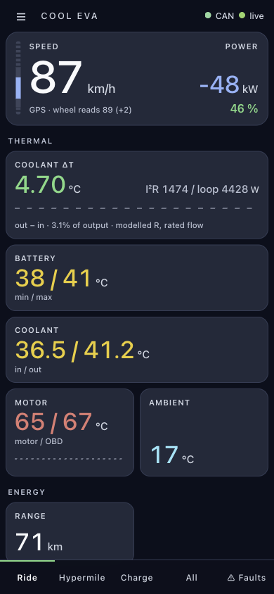
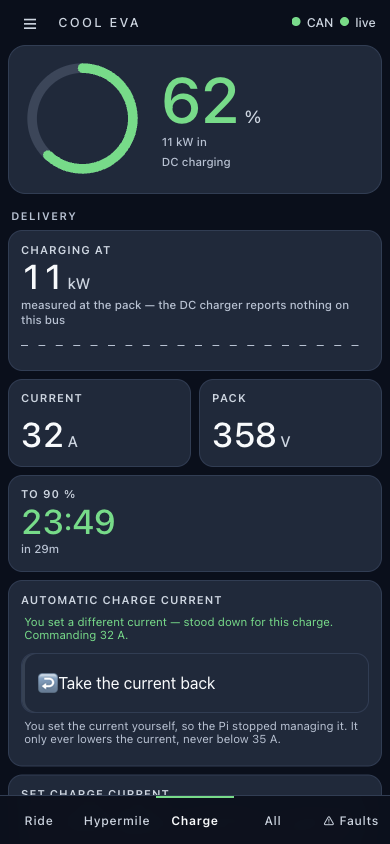
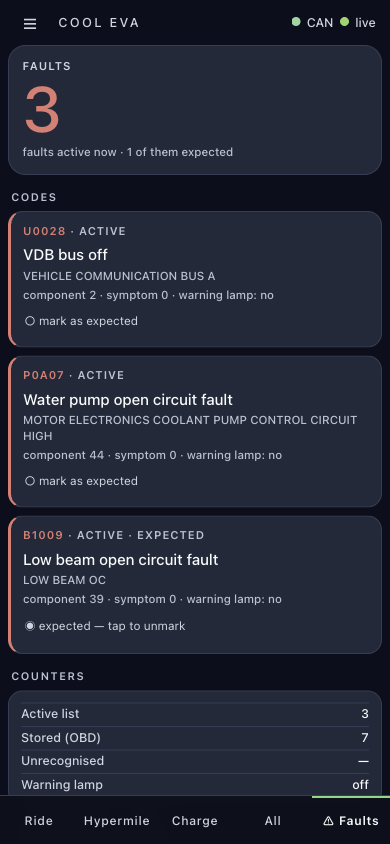

# Cool Eva

Cool Eva puts an Energica's battery temperature, battery percentage, charging, speed and faults on your phone. A Raspberry Pi reads the bike through a Korlan USB-CAN adapter and serves a live dashboard. You can also save encrypted ride history for later, or add temperature probes and a fan to a custom coolant loop.

It is developed on a **2021 Eva Ribelle**. Other models need checking: some displays assume its 81-cell pack and current limits. An Experia or another motorcycle is an untested adaptation. **A stock Energica needs no watercooling hardware or BMS modification.**

## What it looks like

Current dashboard with sample data; coolant readings use the optional probes. Tap a screenshot to enlarge it.

| Ride | Charge | Faults |
| :-: | :-: | :-: |
| [](docs/images/dashboard-ride-dark.png) | [](docs/images/dashboard-charge-dark.png) | [](docs/images/dashboard-faults-dark.png) |
| Speed, power, cooling. | Charge and current. | Named trouble codes. |

## What to buy

| Item | What you need it for |
| --- | --- |
| Raspberry Pi Zero 2 W | Runs the dashboard. |
| microSD card and card reader | Holds Raspberry Pi OS, the software and saved rides. |
| [8devices Korlan USB2CAN — OBD2 version](https://www.8devices.com/products/korlan) | Plugs straight into the diagnostic port on every Energica. |
| Micro-USB OTG adapter/cable | Connects the Korlan to the Pi's **USB** data port; a charge-only cable will not work. |
| Pi power supply, wiring and enclosure | Protected, regulated micro-USB power and secure mounting; use a mains Pi supply for setup. |
| A computer and phone hotspot | Flashes the card and installs the software. |

**Optional cooling hardware:** [Coolant probes and a radiator fan](docs/cooling-hardware.md). A stock bike needs neither, and SPI can stay off.

## Connect the hardware

With the bike switched off, plug the OBD2 Korlan into its diagnostic port and connect it to the Pi's **USB** port. Power the Pi separately through **PWR IN**. **Never connect the bike's 12 V directly to the Pi.** See [power and wiring](docs/hardware.md#connections).

The bike's other CAN connector leaves OBD2 free, but needs a sourced plug and soldering. Pi + OBD2 Korlan is the plug-and-play route. Daniel uses an **OBD2 Y-splitter**, bought online, when he needs the port for BMS configuration work.

## Setup

Commands below say where to run them. Choose username **`pi`** to use them unchanged; [full manual instructions](docs/manual-install.md) cover the details.

### 1. Prepare the phone and card — on your computer

The Zero 2 W needs **2.4 GHz Wi-Fi**. On iPhone, turn on **Personal Hotspot → Maximize Compatibility** if available. Keep the hotspot settings page open for about 20 seconds when the Pi boots so it can join.

Use [Raspberry Pi Imager](https://www.raspberrypi.com/software/) to flash **64-bit Raspberry Pi OS**. Set hostname **`cool-eva`**, username **`pi`**, a password, **SSH enabled**, and your hotspot's Wi-Fi name and password. Insert the card and power the Pi.

### 2. Connect — on your computer

Join the same hotspot. In **PowerShell (Windows)** or **Terminal (macOS/Linux)**, run `ssh pi@cool-eva.local`. Accept the new Pi's host key and enter your password. You are now typing on the Pi. If the name fails, [connect using its IP address](docs/manual-install.md#2-connect--on-your-computer).

### 3. Install the software — on the Pi

<!-- for-now: #324 -->

For now, [prepare Node 24, build tools and swap](docs/manual-install.md#prepare-node-and-swap), then paste this on the Pi; installation takes several minutes:

```sh
git clone https://github.com/danieltroger/cool-eva.git /home/pi/cool-eva
cd /home/pi/cool-eva
rm package-lock.json && npm install
git checkout -- package-lock.json
```

### 4. Enable saved ride history — on your computer

<!-- for-now: #327 -->

For now, follow the [computer key setup](docs/manual-install.md#4-enable-saved-ride-history--on-your-computer): run `node --experimental-strip-types scripts/generate-log-key.ts`, back up the private key and copy only the public key to the Pi; without it, the dashboard works but no rides are saved.

### 5. Before the first service start

[Read what can change the bike](#what-can-change-the-bike).

### 6. Start and check — on the Pi

<!-- for-now: #324 -->

For now, start the service with:

```sh
cd /home/pi/cool-eva
sudo "$(command -v node)" --experimental-strip-types scripts/setup-service.ts
```

With the **bike awake and parked**, open the dashboard below and check for live readings. See [startup and ride-log checks](docs/manual-install.md#6-start-and-check--on-the-pi) if anything is missing.

## Open the dashboard

- **Bluetooth:** [Connect over BLE](docs/connecting-over-bluetooth.md) using **Chrome on Android** or **Bluefy on iPhone**. The experimental [iOS app](docs/ios-app.md) requires an Xcode build and has not been tested on a phone. Bluetooth needs a [secret set on the Pi over Wi-Fi](docs/dashboard.md) first; after that, it avoids waiting on the hotspot settings page. A browser must first load the hosted page online.
- **Wi-Fi/hotspot:** open **[http://cool-eva.local](http://cool-eva.local)** on the same network in any browser. Viewing works without internet. The Pi still needs Wi-Fi internet for **Menu → Update**, even when the phone uses Bluetooth. See [dashboard details and IP fallback](docs/dashboard.md) or [update help](docs/deploy.md#running-it).

Use the phone while parked. Missing coolant or detailed cell readings on a stock bike is normal; see [what each screen shows](docs/dashboard.md).

## What can change the bike

- Starting Cool Eva enrolls the Pi with the bike's Bluetooth hub, which remembers **one authorized device**; it can replace your existing pairing. Read [pairing details](docs/bike-changes.md#bluetooth-pairing-before-startup) before starting.
- Telemetry sends diagnostic read requests. **Automatic DC charge management starts in automatic mode** and can request current changes without asking each time; on stock BMS settings it only changes the dash's maximum-current figure. See [controls and limits](docs/bike-changes.md).
- Manual bike actions take two taps and vehicle-state checks; some are irreversible. An enabled optional fan can start by itself. Read [actions, gates and fan precautions](docs/bike-changes.md).

## Get help

For setup trouble, [download Claude Code](https://code.claude.com/docs/en/quickstart) on your computer, open this project and ask Claude to figure it out. Please also [send Daniel feedback through a GitHub issue](https://github.com/danieltroger/cool-eva/issues/new) about how to improve the setup. The [help checklist](docs/support.md) explains useful error details and what to keep private.

## Going further

| You want to… | Read |
| --- | --- |
| Check wiring or add cooling hardware | [Hardware](docs/hardware.md) · [Probes, fan and fittings](docs/cooling-hardware.md) |
| Change configuration | [Configuration reference](docs/configuration.md) |
| Download and use ride history | [Encrypted ride logs](docs/ride-log.md) · [Grafana and `rides.db`](docs/grafana.md) |
| View rides on a laptop map | [Run the map viewer](map/README.md) · [Map findings](docs/ride-map.md) |
| Save a waypoint or connect by Bluetooth | [Waypoints / Siri](docs/waypoints.md#saving-a-waypoint-from-siri) · [Phone Bluetooth guide](docs/connecting-over-bluetooth.md) |
| Use service mode or add a parameter table | [VCU parameters and writes](docs/vcu-parameters.md) · [Adding your bike's VCU parameter table](docs/vcu-parameters.md#adding-your-bikes-vcu-parameter-table) |
| Understand readings and their limitations | [Signal reference](docs/signals.md) · [CAN findings](docs/can-decode-findings.md) · [Trouble codes and checks](docs/diagnostics-and-checks.md) |
| Develop or replay data without the bike | [Development](docs/development.md) · [Dashboard decisions](docs/dashboard-decisions.md) |

## Licence

AGPL-3.0 — see [`LICENSE`](LICENSE). It reverse-engineers a vehicle you own and talks to safety-relevant hardware; there is no warranty of any kind, and what you plug into your own motorcycle is your responsibility.
