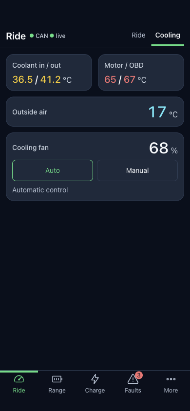
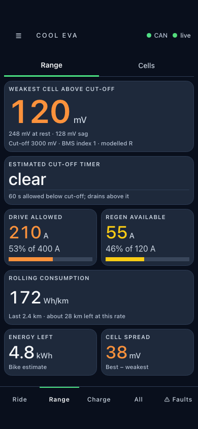
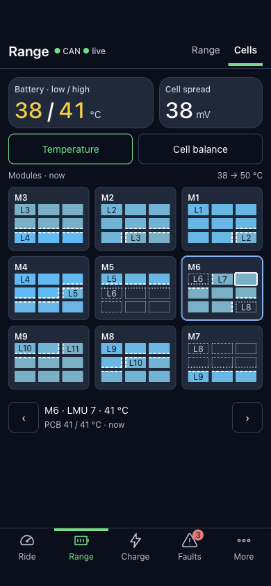
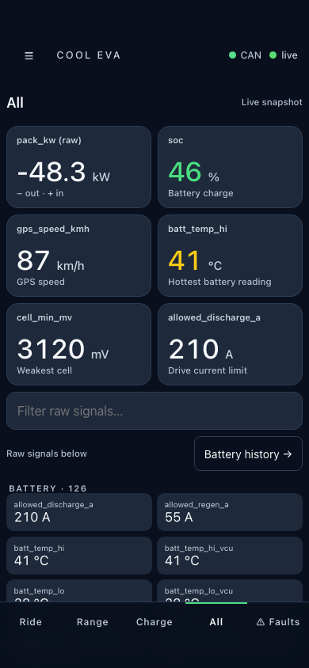

# Cool Eva

Cool Eva puts an Energica's battery temperature, battery percentage, charging, speed and faults on your phone. A Raspberry Pi reads the bike through a Korlan USB-CAN adapter and serves a live dashboard. You can also save encrypted ride history for later, or add temperature probes and a fan to a custom coolant loop.

It is developed on a **2021 Eva Ribelle**. Other models need checking: some displays assume its 81-cell pack and current limits. An Experia or another motorcycle is an untested adaptation. **A stock Energica needs no watercooling hardware or BMS modification.**

## What it looks like

Current dashboard with synthetic sample data; coolant readings use the optional probes. Tap a screenshot to enlarge it.

| Ride | Charge | Faults |
| :-: | :-: | :-: |
| [](docs/images/dashboard-ride-dark.png) | [](docs/images/dashboard-charge-dark.png) | [](docs/images/dashboard-faults-dark.png) |
| Speed, power and power limits. | Charging, temperature curve and current request. | Counts and named trouble codes; full report one tap away. |

| Cooling | Range | Cells | All |
| :-: | :-: | :-: | :-: |
| [](docs/images/dashboard-cooling-dark.png) | [](docs/images/dashboard-range-dark.png) | [](docs/images/dashboard-cells-dark.png) | [](docs/images/dashboard-all-dark.png) |
| Temperatures and fan status. | Weak-cell margin and current allowances. | All 81 cell voltages. | Live snapshot; raw signals below. |

## What to buy

| Item | What you need it for |
| --- | --- |
| Raspberry Pi Zero 2 W | Runs the dashboard. |
| microSD card and card reader | Holds Raspberry Pi OS, the software and saved rides. |
| [8devices Korlan USB2CAN — OBD2 version](https://www.8devices.com/products/korlan) | Plugs straight into the diagnostic port on every Energica. |
| Micro-USB OTG adapter/cable | Connects the Korlan to the Pi's **USB** data port; a charge-only cable will not work. |
| Pi power supply, wiring and enclosure | Protected, regulated micro-USB power and secure mounting; use a mains Pi supply for setup. |
| A computer and phone hotspot | Flashes the card and installs the software. |

**Optional cooling hardware:** [Coolant probes and a radiator fan](docs/cooling-hardware.md). A stock bike needs neither, and SPI can stay off.

## Connect the hardware

With the bike switched off, plug the OBD2 Korlan into its diagnostic port and connect it to the Pi's **USB** port. Power the Pi separately through **PWR IN**. **Never connect the bike's 12 V directly to the Pi.** See [power and wiring](docs/hardware.md#connections).

The bike's other CAN connector leaves OBD2 free, but needs a sourced plug and soldering. Pi + OBD2 Korlan is the plug-and-play route. Daniel uses an **OBD2 Y-splitter**, bought online, when he needs the port for BMS configuration work.

## Setup

### 1. Flash the card — on your computer

Use [Raspberry Pi Imager](https://www.raspberrypi.com/software/) with **Raspberry Pi Zero 2 W → current Raspberry Pi OS Lite (64-bit)**. Set hostname **`cool-eva`**, username **`pi`**, a password, **SSH enabled**, and an internet-connected Wi-Fi network. Your computer and Pi must join the same network for setup. The Zero 2 W needs **2.4 GHz**; on iPhone, enable **Personal Hotspot → Maximize Compatibility** if available.

Insert the card and use a stable **mains USB supply for the entire installation**, with the motorcycle parked. Have both the home Wi-Fi and phone-hotspot names/passwords ready. [Detailed setup and IP fallback](docs/manual-install.md).

### 2. Make a recording key — on your computer

Open [the recording key page](https://cool-eva-keys.cool-eva.workers.dev), generate a pair, download both named PEM files and back up the **private** key away from the Pi. Setup takes **only the public PEM**; open that public file in a text editor to copy its complete block. Existing owners can keep their key. You can skip recording during setup and add the public key later in Settings → Ride recording; until then, **no rides are saved**. No laptop Node installation is needed. [Key backup and phone-only handoff](docs/hosted-pages.md#make-recording-keys).

### 3. Install and start — on your computer

Read [what can change the bike](#what-can-change-the-bike) first. Paste this **one line** into **Windows PowerShell or macOS Terminal**:

```sh
ssh -tt pi@cool-eva.local "sudo install -d -m 700 /var/cache/cool-eva-install && sudo curl -fsSL --proto '=https' --proto-redir '=https' https://github.com/danieltroger/cool-eva/releases/latest/download/install.sh -o /var/cache/cool-eva-install/install.sh && sudo sh /var/cache/cool-eva-install/install.sh"
```

Accept the new Pi's host key and enter the Imager password when asked. Substitute your username/address if different. [SSH help covers missing Windows OpenSSH, invisible password/key input, re-imaged host keys and the IP fallback](docs/manual-install.md#2-connect--on-your-computer). Type **BENCH** only with stable mains power. Answer the network and public-key prompts; enable optional probes/fan only if already wired. Setup handles OS packages, swap, service installation/start and the startup checks.

**Do not unplug the Pi during OS catch-up.** If SSH closes, keep power on and paste the same line again to resume. A migration error that says **stop and ask for help** needs help instead of repeated retries.

When setup prints **“Dashboard ready”**, open that address. It also reports the running bundle, encrypted-recording fingerprint or **“NOT SAVING RIDES”**, and whether CAN is present/waiting. Fresh settings leave the motorcycle hub unselected and optional hardware off unless explicitly enabled. Raw CAN capture is off. With the **bike awake and parked**, verify live readings; missing optional readings on a stock bike are normal. [Results and troubleshooting](docs/manual-install.md#5-results-and-help).

Existing checkout owners: keep your checkout and its Update button until the migration route is announced. **Never re-image to migrate.** [Daniel's first migration and backups](docs/bundle-installation.md#daniels-first-real-migration--go-at-the-bike) are separately gated on his explicit GO.

## Open the dashboard

- **Bluetooth:** [Connect over BLE](docs/connecting-over-bluetooth.md) using **Chrome on Android** or **Bluefy on iPhone**. The experimental [iOS app](docs/ios-app.md) requires an Xcode build and has not been tested on a phone. Bluetooth needs a [secret set on the Pi over Wi-Fi](docs/dashboard.md) first; after that, it avoids waiting on the hotspot settings page. A browser must first load the hosted page online.
- **Wi-Fi/hotspot:** open **[http://cool-eva.local](http://cool-eva.local)** on the same network in any browser. Viewing works without internet. The Pi still needs Wi-Fi internet for **Menu → Settings → Cool Eva → Update**, even when the phone uses Bluetooth. See [dashboard details and IP fallback](docs/dashboard.md) or [update help](docs/deploy.md#running-it).

Use the phone while parked. Missing coolant or detailed cell readings on a stock bike is normal; see [what each screen shows](docs/dashboard.md).

## What can change the bike

- Choosing a motorcycle in Settings → Connections and restarting enrolls the Pi with the bike's Bluetooth hub, which remembers **one authorized device**; it can replace your existing pairing. Read [pairing details](docs/bike-changes.md#bluetooth-pairing-before-startup) before starting.
- Telemetry sends diagnostic read requests. **Automatic DC charge management starts in automatic mode** and can request current changes without asking each time; on stock BMS settings its practical effect can be the dash’s maximum-current figure, but it still sends the current request. See [controls and limits](docs/bike-changes.md).
- Manual bike actions take two taps and vehicle-state checks; some are irreversible. An enabled optional fan can start by itself. Read [actions, gates and fan precautions](docs/bike-changes.md).

## Get help

For setup trouble, [download Claude Code](https://code.claude.com/docs/en/quickstart) on your computer, open this project and ask Claude to figure it out. Please also [send Daniel feedback through a GitHub issue](https://github.com/danieltroger/cool-eva/issues/new) about how to improve the setup. The [help checklist](docs/support.md) explains useful error details and what to keep private.

## Going further

| You want to… | Read |
| --- | --- |
| Check wiring or add cooling hardware | [Hardware](docs/hardware.md) · [Probes, fan and fittings](docs/cooling-hardware.md) |
| Change configuration | [Configuration reference](docs/configuration.md) |
| Inspect Daniel's personal BMS file or select changes for your own pack | [BMS compatibility, hazards, file and agent prompt](docs/bms-config.md) |
| Download and use ride history | [Encrypted ride logs](docs/ride-log.md) · [Grafana and `rides.db`](docs/grafana.md) |
| View rides on a laptop map | [Run the map viewer](map/README.md) · [Map findings](docs/ride-map.md) |
| Save a waypoint or connect by Bluetooth | [Waypoints / Siri](docs/waypoints.md#saving-a-waypoint-from-siri) · [Phone Bluetooth guide](docs/connecting-over-bluetooth.md) |
| Use service mode or add a parameter table | [VCU parameters and writes](docs/vcu-parameters.md) · [Adding your bike's VCU parameter table](docs/vcu-parameters.md#adding-your-bikes-vcu-parameter-table) |
| Understand readings and their limitations | [Signal reference](docs/signals.md) · [CAN findings](docs/can-decode-findings.md) · [Trouble codes and checks](docs/diagnostics-and-checks.md) |
| Develop or replay data without the bike | [Development](docs/development.md) · [Dashboard decisions](docs/dashboard-decisions.md) |

## Licence

AGPL-3.0 — see [`LICENSE`](LICENSE). It reverse-engineers a vehicle you own and talks to safety-relevant hardware; there is no warranty of any kind, and what you plug into your own motorcycle is your responsibility.
